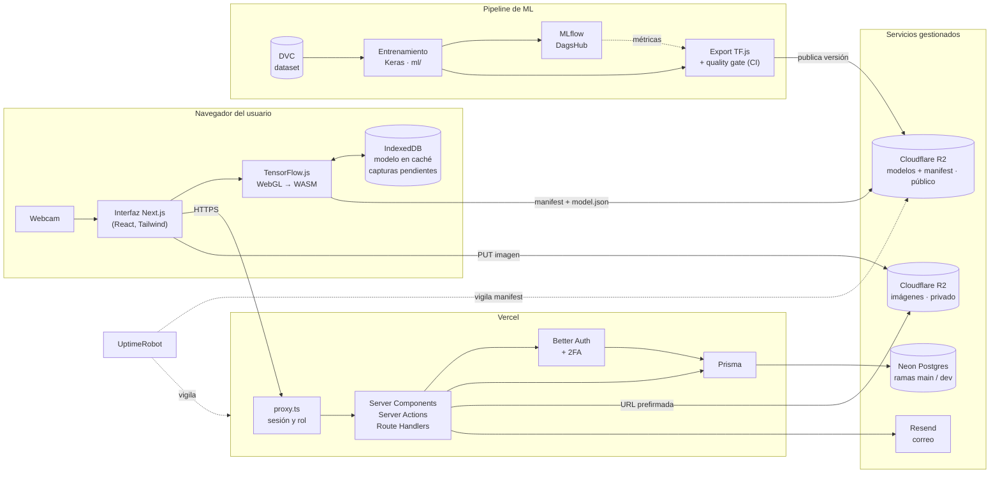
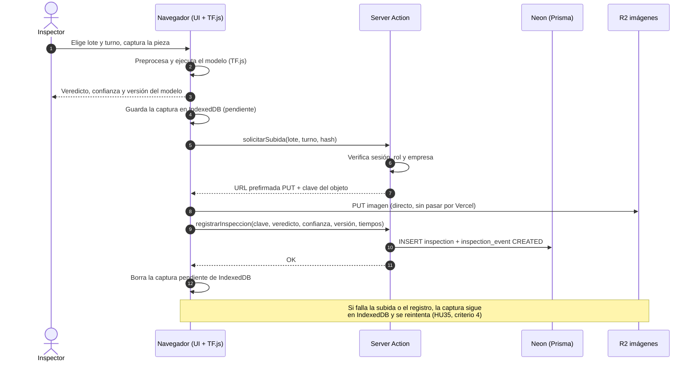
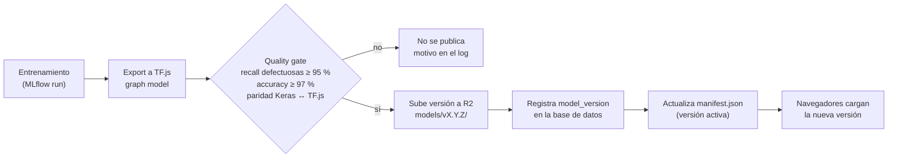

# Arquitectura de RikuyDeep

RikuyDeep es una aplicación web multiempresa para la inspección visual de piezas de fundición. Un modelo de visión clasifica cada pieza como **OK** o **defectuosa** directamente en el navegador del inspector, y la aplicación guarda la trazabilidad de cada inspección para los dashboards y reportes de calidad.

Tarea: RIKDP-86 (HU07-T01 · diagrama de arquitectura y ADR de stack), dentro de HU08 · Crear la aplicación web.

Documentos relacionados:

- [Modelo de datos](modelo-datos.md) (RIKDP-87)
- [Decisiones de arquitectura (ADR)](../adr/README.md)
- [Identidad visual](../identidad-visual.md)

## Diagrama de componentes

### Responsabilidades

| Componente | Responsabilidad | Historias |
| --- | --- | --- |
| **Interfaz Next.js** | Pantallas (landing, login, inspección, historial, dashboard, administración). Captura de la webcam y subida de imágenes | HU12, HU35, HU37, HU39, HU40, HU44 |
| **TensorFlow.js** | Carga el modelo indicado por el manifest, lo guarda en IndexedDB y ejecuta la inferencia. Preprocesamiento idéntico al de `ml/preprocessing.py` | HU26 |
| **IndexedDB** | Caché del modelo y cola de capturas que aún no se han subido, para reintentar sin perder la imagen | HU26, HU35 |
| **`proxy.ts`** (antes `middleware`) | Primera barrera: sesión válida y rol permitido para la ruta. No sustituye a la autorización en el servidor | HU32 |
| **Server Actions y Route Handlers** | Lógica de negocio, autorización por rol y empresa, escritura en base de datos y firma de URLs de R2 | HU24, HU30–HU33, HU40 |
| **Better Auth** | Login, sesiones, bloqueo por intentos, recuperación de contraseña, invitaciones y 2FA | HU19, HU20, HU29 |
| **Prisma + Neon** | Persistencia relacional. Rama `dev` de Neon para previews y desarrollo, `main` para producción | HU13 |
| **R2 · imágenes** | Imágenes originales de cada inspección. Bucket privado: lectura y escritura solo con URL firmada de corta duración | HU24, HU35 |
| **R2 · modelos** | Versiones del modelo TF.js (`model.json` + shards) y el `manifest.json` que indica la versión activa | HU25, HU26 |
| **Resend** | Invitaciones, recuperación de contraseña y aviso de nuevos leads | HU14, HU20, HU23, HU30 |
| **Pipeline de ML** | Dataset versionado con DVC, entrenamiento y experimentos en MLflow, exportación a TF.js con quality gate | HU04–HU25 |
| **GitHub Actions** | CI (`.github/workflows/ci.yml`) y, más adelante, regresión del modelo y publicación | HU02, HU22, HU25 |
| **UptimeRobot** | Vigila la web y la URL del manifest, y avisa por correo | HU43 |

## Flujo principal: inspeccionar una pieza

Lo que el servidor guarda de cada inspección (veredicto, confianza, versión del modelo, umbral aplicado, imagen) permite auditarla y reevaluarla más tarde con otra versión del modelo.

## Flujo de publicación del modelo

Volver a la versión anterior consiste en cambiar el manifest (HU25). El formato del manifest y el detalle de la inferencia en el navegador son la tarea RIKDP-88 (HU07-T03, Daniel Sánchez).

## Seguridad

- **Aislamiento por empresa:** todas las tablas de negocio llevan `company_id` y todas las consultas filtran por la empresa de la sesión ([ADR 0003](../adr/0003-multiempresa-con-columna-company-id.md)).
- **Autorización en el servidor:** `proxy.ts` solo hace una primera comprobación. Cada Server Action y Route Handler vuelve a verificar rol y empresa. Un acceso denegado responde 403 con `forbidden()` de Next 16 y se registra en `access_denied_log` (HU32).
- **Imágenes privadas:** el bucket de imágenes no es público; las URLs firmadas caducan en minutos.
- **Inferencia en el cliente:** el veredicto lo calcula el navegador, así que un usuario autenticado podría manipularlo. Se acepta en el MVP porque los inspectores son empleados autenticados, y queda mitigado guardando la imagen y la versión del modelo para auditar ([ADR 0002](../adr/0002-inferencia-en-el-navegador.md)).
- **Cabeceras:** CSP compatible con WebGL y WASM (`'wasm-unsafe-eval'`), HSTS y protección CSRF (HU48).

## Entornos

| Entorno | Web | Base de datos | R2 |
| --- | --- | --- | --- |
| Desarrollo local | `next dev` | Neon rama `dev` | Bucket de desarrollo |
| Preview (cada PR) | Vercel preview | Neon rama `dev` | Bucket de desarrollo |
| Producción | Vercel (`main`) | Neon rama `main` | Bucket de producción |

Las variables de entorno se configuran por entorno en Vercel; ningún secreto va en el repositorio (HU13).

## Puntos abiertos

| Tema | Detalle | Responsable |
| --- | --- | --- |
| Tamaño de entrada del modelo | `ml/preprocessing.py` usa **400×400**; HU06 y HU26 dicen **224×224**. Hay que fijar uno solo, porque TF.js debe replicar el mismo preprocesamiento | RIKDP-88 / equipo de ML |
| Formato del manifest | Campos, URL y caché del `manifest.json` | RIKDP-88 |
| Carpeta `apps/inference` | HU01 la menciona, pero ya no hay servidor de inferencia (FastAPI) desde la reestructuración del 28/10. No se crea | Revisión de arquitectura (RIKDP-89) |
