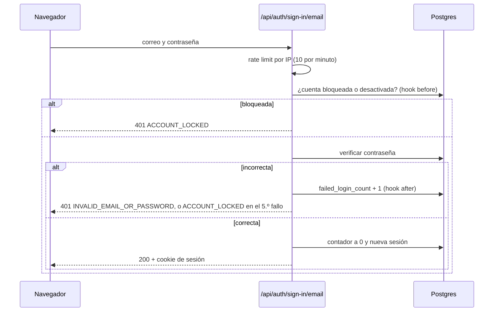

# Autenticación

Inicio de sesión, bloqueo por intentos, recuperación de contraseña y verificación en dos pasos con [Better Auth](https://www.better-auth.com) 1.7. HU19 · RIKDP-30: RIKDP-132, RIKDP-133, RIKDP-134, RIKDP-137 y RIKDP-138. HU29 · RIKDP-40: RIKDP-167, RIKDP-168 y RIKDP-169.

## Piezas

| Pieza | Archivo | Qué hace |
| --- | --- | --- |
| Configuración | `apps/web/src/lib/auth/server.ts` | Instancia de Better Auth con el adaptador de Prisma, creada al primer uso con `getAuth()` |
| Reglas | `apps/web/src/lib/auth/config.ts` | Duraciones, límites, rutas y mensajes de error. Se puede usar desde el cliente |
| Bloqueo | `apps/web/src/lib/auth/lockout.ts` | Contador de intentos fallidos por cuenta |
| Correo | `apps/web/src/lib/auth/emails.ts` | Enlace de recuperación por Resend |
| Sesión en páginas | `apps/web/src/lib/auth/session.ts` | `getCurrentUser()`: comprueba la sesión en la base y redirige al login si no hay |
| Endpoints | `apps/web/src/app/api/auth/[...all]/route.ts` | API de Better Auth en `/api/auth/*` |
| Proxy | `apps/web/src/proxy.ts` | Comprobación optimista de la cookie en `/panel/*` |
| Pantallas | `/ingresar`, `/recuperar`, `/restablecer`, `/panel` | Formularios de cliente con `authClient` |

## Decisiones

- **Sin registro público.** `disableSignUp: true`. Las cuentas se crean al aceptar una invitación ([empresas e invitaciones](empresas-e-invitaciones.md), HU23; HU30 para los usuarios de planta). El seed y las pruebas usan `createCredentialUser()`, que usa el mismo hash scrypt que Better Auth.
- **Sesión en base de datos**, cookie `HttpOnly`. Dura 8 horas (un turno) y se renueva cada hora de uso.
- **Las pantallas llaman a `/api/auth` desde el navegador** y no desde una Server Action. Así el rate limit de Better Auth, que solo actúa sobre peticiones HTTP, protege también el formulario.
- **Doble comprobación.** `proxy.ts` solo mira si existe la cookie, sin ir a la base, para redirigir rápido. La comprobación que cuenta la hace `getCurrentUser()` en cada página: valida la sesión, que la cuenta siga activa y que su empresa no esté desactivada. Los permisos por rol los comprueba `getPageAccess()` (HU32).
- **Instancia perezosa.** `getAuth()` crea Better Auth en la primera petición, así `next build` no necesita la base ni `BETTER_AUTH_SECRET`.

## Inicio de sesión y bloqueo (criterio 1)

- **5 fallos seguidos** bloquean la cuenta **15 minutos**, aunque luego se escriba la contraseña correcta. El contador vive en `user.failed_login_count` y `user.locked_until`. Se incrementa con una sola sentencia SQL `UPDATE … FOR UPDATE`, así dos intentos simultáneos no pueden saltarse el límite.
- Un login correcto o un cambio de contraseña ponen el contador a cero. Al vencer el bloqueo, el siguiente fallo vuelve a contar desde 1.
- Un correo que no existe responde igual que una contraseña incorrecta. Un usuario desactivado (`active = false`) también.
- El bloqueo responde 401 con el código `ACCOUNT_LOCKED`. Usa el mismo estado que una contraseña incorrecta porque Better Auth conserva el estado original cuando el error sale del hook posterior; la pantalla distingue los casos por el código.

### Rate limit (RIKDP-134)

Por IP, guardado en la tabla `rate_limit` para que valga entre las instancias serverless de Vercel:

| Ruta | Límite |
| --- | --- |
| `/sign-in/email` | 10 por minuto |
| `/request-password-reset` | 5 cada 15 minutos |
| `/reset-password` | 10 cada 15 minutos |
| Resto de `/api/auth` | 60 por minuto |

La IP sale de `x-forwarded-for`, que en Vercel pone la propia plataforma. El límite de las demás acciones que escriben datos, por ejemplo el formulario de demo, queda para HU48 (RIKDP-59).

## Recuperación de contraseña (criterios 2 y 3)

1. En `/recuperar` el usuario escribe su correo. La respuesta es **la misma exista o no la cuenta**, y solo se envía correo si existe.
2. El correo, de texto plano y enviado por Resend, lleva el enlace `/restablecer?token=…`. El token **vence en 30 minutos** y es de **un solo uso**: Better Auth borra la verificación al usarla.
3. En `/restablecer` se elige la nueva contraseña (10 a 128 caracteres). Al guardarla, en una sola transacción, se **revocan todas las sesiones** del usuario (`revokeSessionsOnPasswordReset`) y se quita el bloqueo.
4. La página `/restablecer` usa `referrer: no-referrer` para que el token no salga a otros sitios.

Sin `RESEND_API_KEY`, en desarrollo el enlace se escribe en la consola del servidor y en producción solo queda un aviso.

## Verificación en dos pasos (HU29)

Plugin `twoFactor` de Better Auth con TOTP (app autenticadora) y códigos de respaldo. Piezas propias:

| Pieza | Archivo | Qué hace |
| --- | --- | --- |
| Política | `apps/web/src/lib/auth/two-factor-policy.ts` | `isTwoFactorRequired()`: superadmin siempre; el resto si su empresa la exige (`company.require_two_factor`); las estaciones (`STATION`) nunca |
| Segundo paso del login | `apps/web/src/components/auth/two-factor-step.tsx` | Código de 6 dígitos o código de respaldo, y «Confiar en este equipo 30 días» |
| Configuración | `/panel/cuenta/seguridad` | Activar (QR + primer código), regenerar códigos y desactivar. El admin de planta exige la 2FA a su empresa |

**Activación (criterio 1).** Con la contraseña, `/two-factor/enable` genera el secreto y los códigos, pero la cuenta solo queda con 2FA cuando `/two-factor/verify-totp` acepta el primer código (`two_factor.verified`). Al terminar se cierran las demás sesiones.

**Códigos de respaldo (criterio 2).** Diez códigos `xxxxx-xxxxx` que se muestran una vez (copiar o descargar). Cada uno se borra al usarlo. Regenerarlos invalida los anteriores.

**Obligatoriedad (criterio 3).** Quien la tiene obligatoria y no la activó solo puede entrar a `/panel/cuenta/seguridad`: `getCurrentUser()` lo redirige ahí, `getActionUser()` no le deja usar Server Actions y `loadActor()` (HU24) no le deja registrar inspecciones. No puede desactivarla: un hook `before` de `/two-factor/disable` responde 403 `TWO_FACTOR_REQUIRED`.

**Seguridad.**
- El secreto TOTP y los códigos de respaldo se guardan **cifrados** con `BETTER_AUTH_SECRET`. Cambiar esa variable deja inservibles los 2FA activos.
- Tras la contraseña correcta no hay sesión hasta el código: Better Auth deja una cookie firmada de desafío que admite 5 intentos.
- 5 códigos incorrectos seguidos bloquean el segundo paso 15 minutos (`two_factor.locked_until`). El rate limit de `/two-factor/*` es de 15 peticiones por minuto e IP.
- Si alguien pierde el móvil y los códigos, `npm run reset:two-factor` (desde `apps/web`, con `DIRECT_URL`) le quita la 2FA y cierra sus sesiones. Si su cuenta la tiene obligatoria, deberá activarla otra vez al entrar.

## Pruebas

- `src/lib/auth/auth.test.ts` (integración con Postgres, a través del handler HTTP): login, conteo y bloqueo, desbloqueo al vencer, usuario desactivado, rate limit, mensaje neutro, vencimiento a 30 minutos, revocación de sesiones, token reutilizado y token vencido.
- `src/lib/auth/config.test.ts`: destino seguro tras el login y mensajes de error.
- `src/lib/auth/two-factor.test.ts` (integración, handler HTTP): activación con verificación del primer código y secretos cifrados, login en dos pasos, código de respaldo de un solo uso, regeneración, desactivación y 2FA obligatoria (superadmin y empresa).
- `src/lib/auth/two-factor-policy.test.ts`: política por rol y empresa.
- `e2e/two-factor.spec.ts` (Playwright): `@smoke` activación con el QR → login con código → código de respaldo reutilizado; `@regression` superadmin sin 2FA bloqueado hasta activarla (responsive y axe) y admin que la exige a su planta.
- `e2e/auth.spec.ts` (Playwright):
  - `@smoke`: entrar al panel, cerrar sesión y contraseña incorrecta.
  - `@regression`: bloqueo en pantalla, `?next=` externo, recuperación con mensaje neutro y enlace inválido.

Los casos formales siguen en PT2 (RIKDP-135) y PT4 (RIKDP-136, RIKDP-139).
