# Empresas e invitaciones

El superadministrador da de alta las empresas (plantas de fundición), invita a su primer administrador y puede desactivarlas. HU23 · RIKDP-34: RIKDP-146 (pantallas) y RIKDP-147 (invitación por correo).

## Alcance del superadministrador

El superadministrador **opera la plataforma, no la planta**: no pertenece a ninguna empresa (`company_id` nulo), así que no inspecciona, no corrige veredictos y no ve datos de las empresas. Sus permisos (`src/lib/authz`) son `empresas:gestionar`, `modelos:gestionar`, `leads:gestionar`, `monitoreo:ver` y `auditoria:ver`. Esto coincide con las reglas de trazabilidad de HU24 (`src/lib/inspections/rules.ts`) y con el ADR 0003.

## Piezas

| Pieza | Archivo | Qué hace |
| --- | --- | --- |
| Validación | `apps/web/src/lib/companies/schema.ts` | Formularios de empresa, invitación y aceptación (zod) |
| Empresas | `apps/web/src/lib/companies/service.ts` | Listar, crear, editar, activar y desactivar. Cada función exige `empresas:gestionar` |
| Invitaciones | `apps/web/src/lib/invitations/service.ts` | Crear, previsualizar y aceptar invitaciones. La reutilizará HU30 |
| Correo | `apps/web/src/lib/auth/emails.ts` | `sendInvitationEmail()` por Resend |
| Acciones | `apps/web/src/app/panel/admin/empresas/actions.ts`, `apps/web/src/app/invitacion/actions.ts` | Server Actions de los formularios |
| Pantallas | `/panel/admin/empresas`, `/panel/admin/empresas/nueva`, `/panel/admin/empresas/[id]`, `/invitacion` | Listado, alta, detalle y aceptación |
| Permisos en páginas | `apps/web/src/lib/auth/session.ts` | `getPageAccess()`: sesión, permiso y registro del acceso denegado |
| Menú | `apps/web/src/components/panel/role-nav.tsx` | Solo muestra los enlaces que el rol puede usar |

## Alta de una empresa (criterios 1 y 2)

```mermaid
sequenceDiagram
  participant S as Superadministrador
  participant W as Next.js (Server Action)
  participant DB as PostgreSQL
  participant R as Resend
  participant A as Administrador de planta
  S->>W: nombre, RUC, zona horaria, nombre y correo del admin
  W->>W: authorize(empresas:gestionar)
  W->>DB: transacción: company + invitation (hash del token)
  W->>R: correo con /invitacion?token=…
  R-->>A: invitación
  A->>W: /invitacion: nombre y contraseña
  W->>DB: transacción: marca la invitación como usada y crea user ADMIN + account
  A->>W: /ingresar
```

- La empresa y la invitación se crean **en la misma transacción**: si el correo ya tiene cuenta, no queda una empresa a medias.
- El token tiene 32 bytes aleatorios. **En la base solo se guarda su SHA-256**, así que una copia de la base no sirve para aceptar invitaciones.
- La invitación **vence en 7 días** y es **de un solo uso**: se marca como usada con una sentencia condicional, por lo que dos envíos simultáneos del mismo enlace crean una sola cuenta.
- Enviar otra invitación al mismo correo **invalida las anteriores**.
- La cuenta se crea con el rol y la empresa de la invitación. Quien la acepta solo elige su nombre y su contraseña (10 a 128 caracteres).
- **Sin Resend configurado, o si el envío falla**, la pantalla del superadministrador muestra el enlace para que lo copie y lo envíe él. Con el remitente de pruebas de Resend (`onboarding@resend.dev`) solo se puede enviar al correo dueño de la cuenta de Resend; para enviar a cualquier dirección hay que verificar un dominio y configurar `AUTH_EMAIL_FROM`.

## Desactivación (criterio 3)

- Al desactivar una empresa se **borran las sesiones** de todos sus usuarios en la misma transacción.
- El login rechaza a los usuarios de una empresa desactivada con el mismo error que una contraseña incorrecta (`src/lib/auth/server.ts`), para no revelar qué cuentas existen.
- `getCurrentUser()` y `loadActor()` (HU24) también la rechazan, así que una sesión que se haya quedado viva tampoco sirve.
- Sus invitaciones pendientes no se pueden aceptar y no se pueden enviar nuevas mientras esté desactivada. Los datos se conservan y al reactivarla todo vuelve a funcionar.

## Pruebas

- `src/lib/companies/schema.test.ts`: validación de los formularios.
- `src/lib/companies/service.test.ts` (integración con Postgres): alta con invitación, permisos, RUC único, transacción sin empresas a medias, edición, aceptación de un solo uso (también simultánea), vencimiento, reenvío, desactivación con cierre de sesiones y registro del acceso denegado.
- `src/lib/auth/auth.test.ts`: los usuarios de una empresa desactivada no pueden iniciar sesión.
- `src/lib/authz/authz.test.ts`: alcance del superadministrador.
- `e2e/companies.spec.ts` (Playwright):
  - `@smoke`: alta, aceptación de la invitación, login del administrador, enlace reutilizado y desactivación.
  - `@regression`: un usuario de planta no entra a la gestión de empresas; las pantallas no tienen scroll horizontal a 360, 768 y 1280 px y pasan axe.
