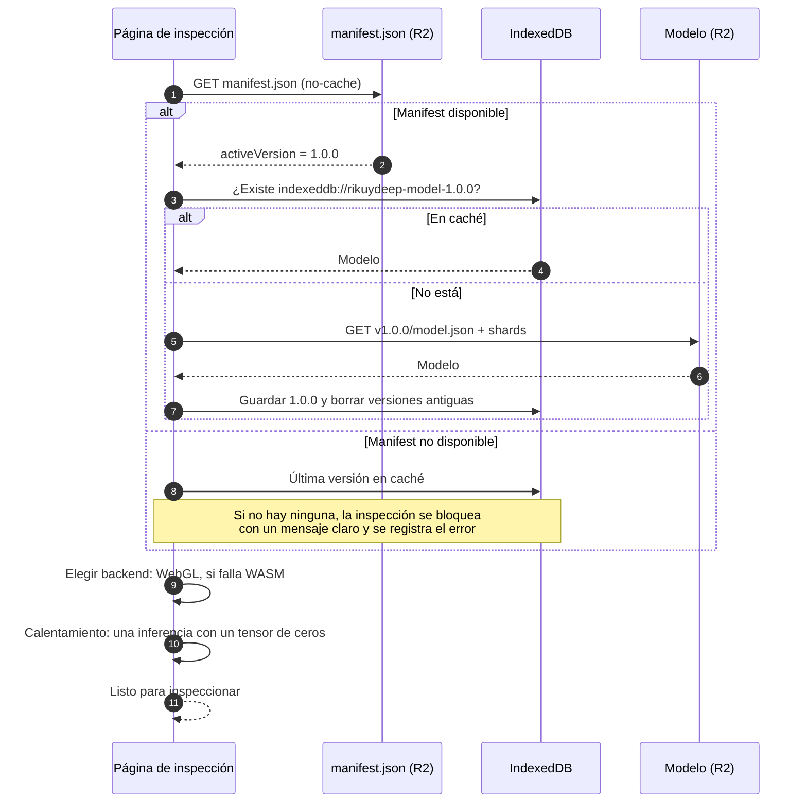

# Inferencia en el navegador y manifest de modelos

Diseño de cómo la web carga el modelo, lo ejecuta con TensorFlow.js y cambia de versión sin desplegar la aplicación.

Tarea: RIKDP-88 (HU07-T03 · diseño de la inferencia en el navegador y del manifest de modelos). Lo implementan HU25 (exportación y publicación) y HU26 (inferencia en la web).

Decisiones relacionadas: [ADR 0002 · inferencia en el navegador](../adr/0002-inferencia-en-el-navegador.md) y [ADR 0006 · manifest de modelos](../adr/0006-manifest-de-modelos.md).

## El modelo actual

Datos del notebook `RIKUY_DEEP_G2.ipynb` (HU17, corrida `run01_lr1e-4_unfreeze15_drop30`):

| Propiedad | Valor |
| --- | --- |
| Arquitectura | MobileNetV2 (ImageNet) con fine-tuning, `GlobalAveragePooling2D`, `Dropout`, `Dense(1, sigmoid)` |
| Entrada | `[1, 400, 400, 3]`, RGB, `float32` en **[0, 1]** |
| Normalización interna | Capa `Rescaling(2, offset=-1)` dentro del modelo: pasa de [0, 1] a [-1, 1]. **La web no la aplica** |
| Salida | `[1, 1]`: probabilidad de que la pieza sea **defectuosa** (clase 1) |
| Umbral | **0,2649**, elegido en validación para priorizar el recall de defectuosas |
| Métricas en test | accuracy 98,97 %, recall de defectuosas 98,29 %, precisión de defectuosas 100 %, 2 falsos negativos de 117 |

El tamaño de entrada es **400×400**. Se decidió en la revisión de arquitectura del 2026-11-01 (RIKDP-89); HU06 y HU26 decían 224×224 y se corrigieron.

## Exportación (HU25)

1. Cargar el mejor checkpoint `best_model.keras` y exportarlo como SavedModel: `model.export("export/saved_model")`.
2. Convertir a graph model:

   ```bash
   tensorflowjs_converter \
     --input_format=tf_saved_model \
     --output_format=tfjs_graph_model \
     --signature_name=serving_default \
     export/saved_model export/tfjs
   ```

   Se usa *graph model* y no *layers model* porque carga y ejecuta más rápido en el navegador, y no necesita reconstruir las capas de Keras.

3. Verificar la paridad Keras ↔ TF.js en el conjunto dorado (como mucho 2 discrepancias, RIKDP-154) y el quality gate de métricas.
4. Publicar en R2 y actualizar el manifest (ver más abajo).

## Estructura en R2

Bucket público de modelos, servido detrás de un dominio propio (por ejemplo `models.rikuydeep.app`):

```text
manifest.json                      ← versión activa y catálogo de versiones
v1.0.0/
  model.json                       ← topología + índice de pesos
  group1-shard1of4.bin             ← pesos
  …
v1.1.0/
  …
```

| Objeto | `Cache-Control` | Por qué |
| --- | --- | --- |
| `manifest.json` | `no-cache` | Cambiar de versión debe notarse en la siguiente carga |
| `v*/**` | `public, max-age=31536000, immutable` | Una versión publicada nunca cambia; si hay que corregirla, se publica otra |

El bucket necesita CORS con `GET` permitido para el dominio de la app.

## Manifest

Esquema: [`apps/web/src/lib/model/manifest.ts`](../../apps/web/src/lib/model/manifest.ts) (tipos y validación, con pruebas). Ejemplo:

```json
{
  "schemaVersion": 1,
  "activeVersion": "1.0.0",
  "versions": [
    {
      "version": "1.0.0",
      "modelPath": "v1.0.0/model.json",
      "modelSha256": "<sha256 de model.json>",
      "publishedAt": "2026-11-15T12:00:00Z",
      "input": {
        "width": 400,
        "height": 400,
        "channels": 3,
        "scale": 0.00392156862745098,
        "offset": 0
      },
      "output": {
        "activation": "sigmoid",
        "positiveLabel": "DEFECTIVE",
        "negativeLabel": "OK"
      },
      "threshold": 0.2649,
      "metrics": {
        "testAccuracy": 0.9897,
        "testDefectRecall": 0.9829,
        "mlflowRunId": "<run id>"
      }
    }
  ]
}
```

Reglas:

- `activeVersion` debe existir en `versions`. **Volver atrás es cambiar `activeVersion`** a una versión anterior (HU25).
- `modelPath` es relativo a la URL del manifest.
- `input.scale` y `input.offset` describen la normalización que aplica la web: `valor = píxel × scale + offset`. Para el modelo actual, `1/255` y `0`.
- `threshold` acompaña a la versión: un modelo nuevo puede tener otro umbral calibrado.
- Cada versión publicada se registra también en la tabla `model_version` (ver [modelo de datos](modelo-datos.md)).

## Flujo de carga



Detalles:

- **Clave de caché:** `indexeddb://rikuydeep-model-<versión>`. Se guarda con `model.save()` y se carga con `tf.loadGraphModel()`. Al activar una versión nueva se borran las antiguas para no llenar el almacenamiento.
- **Integridad:** si `modelSha256` está presente, se comprueba el hash de `model.json` antes de cargarlo.
- **Backend:** `await tf.setBackend("webgl")`; si falla, `@tensorflow/tfjs-backend-wasm`. Los binarios `.wasm` se sirven desde el propio dominio para cumplir la CSP (`'wasm-unsafe-eval'`, HU48).
- **Calentamiento:** la primera inferencia en WebGL compila shaders y es lenta. Se ejecuta una con ceros al cargar y no se cuenta en las métricas de latencia.

## Preprocesamiento: Python ↔ TensorFlow.js

La web debe reproducir exactamente el preprocesamiento del entrenamiento (`ml/preprocessing.py`):

| Paso | Entrenamiento (Python) | Web (TensorFlow.js) |
| --- | --- | --- |
| 1. Encuadre | Imágenes del dataset ya cuadradas | Recorte cuadrado centrado del fotograma o la imagen (la guía de encuadre de HU35 marca ese cuadrado) |
| 2. Redimensionado | `PIL.Image.resize((400, 400), BILINEAR)` | Dibujar el recorte en un `<canvas>` de 400×400 con `imageSmoothingQuality = "high"` |
| 3. Canales | `convert("RGB")` | `tf.browser.fromPixels(canvas, 3)` |
| 4. Tipo y escala | `float32 / 255` | `.toFloat().mul(scale).add(offset)` con los valores del manifest |
| 5. Lote | — | `.expandDims(0)` → `[1, 400, 400, 3]` |
| 6. [-1, 1] | Dentro del modelo | Dentro del modelo |

Se redimensiona con el canvas y no con `tf.image.resizeBilinear` porque los fotogramas de la cámara (por ejemplo 1280×720) se **reducen**, y el bilineal de TF.js no suaviza al reducir, mientras que PIL sí. Esa diferencia produce bordes dentados y cambia la predicción. La paridad se comprueba en el conjunto dorado (RIKDP-154).

## Postprocesamiento

```text
p = probabilidad de defecto (salida del modelo)
veredicto = DEFECTIVE si p ≥ threshold, OK en otro caso
confianza = p si DEFECTIVE, 1 − p si OK
```

La función `classify()` de `apps/web/src/lib/model/manifest.ts` lo implementa y tiene pruebas. Se guardan en la inspección `predicted_verdict`, `confidence`, `threshold_applied` y `model_version_id`.

Con un umbral de 0,2649, una pieza con `p = 0,30` es **defectuosa con confianza 0,30**. Es lo esperado: el umbral bajo prioriza no dejar pasar defectos. La interfaz debe mostrar el veredicto de forma destacada y la confianza como dato secundario.

## Video en tiempo real (HU44)

- Muestreo configurable (por defecto 2 fps) con `requestVideoFrameCallback`, y nunca más de una inferencia en curso a la vez.
- Todo el preprocesamiento y la inferencia dentro de `tf.tidy()`; el resultado se lee con `await tensor.data()` y se libera con `dispose()`.
- Prueba de fugas: `tf.memory().numTensors` debe quedar estable tras 200 fotogramas.

## Telemetría (HU43)

Por cada inferencia se mide la duración (sin el calentamiento) y el backend. Se envían en lotes a `model_telemetry`. Los errores de carga del manifest o del modelo se registran con su mensaje.

## Rendimiento

400×400 cuesta unas 3,2 veces más cómputo que 224×224. Objetivo de HU26: **p95 < 500 ms** por imagen tras el calentamiento, en el equipo de referencia. Si no se cumple, las opciones por orden son:

1. Cuantizar los pesos a `float16` con `--quantize_float16` (la mitad de tamaño de descarga, sin cambiar la entrada).
2. Reentrenar a 224×224 y publicarlo como una versión nueva del manifest.

## Pruebas

| Prueba | Tarea |
| --- | --- |
| Validación del manifest y de `classify()` | `apps/web/src/lib/model/manifest.test.ts` |
| Paridad Keras ↔ TF.js en el conjunto dorado | RIKDP-154 |
| Inferencia con imágenes OK, defectuosas e inválidas | RIKDP-158 |
| Modelo degradado hace fallar la regresión en CI | RIKDP-145 |
