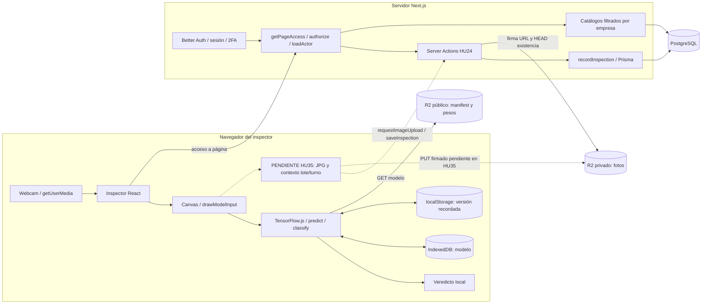
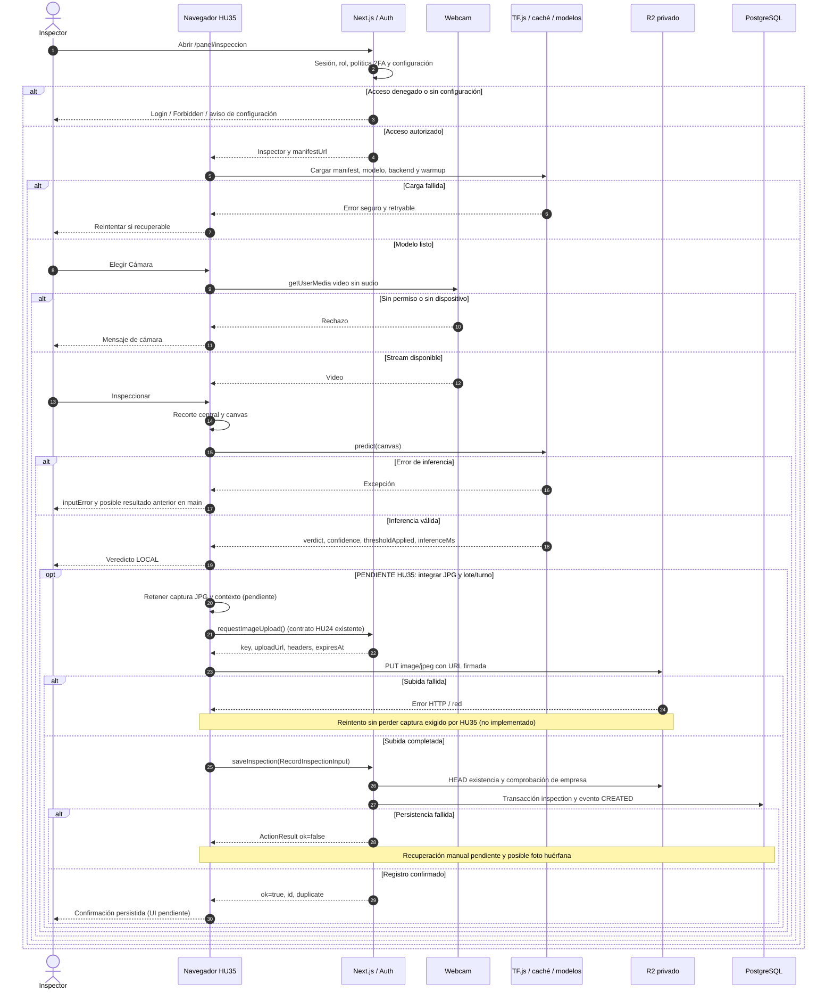

# HU35 · Integración de inspección manual (RIKDP-289)

Auditoría del **2026-11-09**, sobre `origin/main` en `98bbd550e2e694b418a02f93d61cffa764dee41b`.
Este documento describe código disponible, no una certificación del despliegue.
Historia: [RIKDP-46](https://dbravoo.atlassian.net/browse/RIKDP-46).
[Contratos](inspeccion-manual-contratos.md) · [Reproducción](../pruebas/hu35-reproduccion.md) · [Resultados](../ui-ux/RIKDP-289-resultados.md).

## Estado y límite de la integración

La pantalla `/panel/inspeccion` **sí clasifica localmente** una foto o un fotograma de cámara. No genera un archivo JPG, no elige lote/turno, no solicita URL firmada ni llama a `saveInspection`. Por tanto, ver un veredicto no significa haber registrado una inspección. La caché de modelos no es una cola de capturas manuales.

| Capacidad | En main auditado | Sólo PR abierto / pendiente |
| --- | --- | --- |
| Cámara y guía central | `CameraInput`, cámara preferida trasera; sin selector de dispositivo | Selector: RIKDP-187 |
| Captura e inferencia | Video → canvas → TF.js → resultado | Serialización JPG manual: RIKDP-188/192 |
| Carga, error y reintento de modelo | PR #45 fusionado, `idle/loading/retrying/ready/error` | No depende de #57 |
| Permisos de cámara | Distingue `NotAllowedError` de error genérico; cleanup al desmontar | #57 agrega estados, reintento, espera del primer frame, desconexión y limpieza del resultado |
| Lote y turno manuales | Catálogos y validación backend disponibles | Controles e integración HU35: RIKDP-193 |
| R2 y trazabilidad | Server Actions, firma y servicio HU24 disponibles | Conectar a inspector manual: RIKDP-192 |
| Recuperación manual sin perder captura | No hay cola ni blob retenido para subida | RIKDP-194 |
| Estación automática HU44 | JPG, cola y sincronización propios ya en main (#58) | No convierte a HU35 en flujo persistente |
| Webcam física / tiempo extremo a extremo | No comprobados en esta auditoría documental | RIKDP-191; objetivos HU35 <2 s y HU26 p95 <500 ms requieren medición |

PR [#45](https://github.com/d-a-b-o/RIKUY_DEEP_G2/pull/45): cerrado y fusionado; merge `dc9b824`. PR [#57](https://github.com/d-a-b-o/RIKUY_DEEP_G2/pull/57): abierto, no fusionado; head `e0c15e5`. Consultados el 2026-11-09. No se incorporó su código a esta rama. Su diff es una referencia de mejoras propuestas, no evidencia del comportamiento de main.

## Componentes y fronteras

Líneas continuas: componentes o llamadas existentes. Líneas discontinuas: conexión pendiente **desde HU35**, aunque el servicio destino ya exista.

El backend no ejecuta TF.js ni recibe tensores. Better Auth usa `/api/auth/[...all]`; las operaciones de inspección son **Server Actions**, no endpoints REST `/api/inspecciones` implementados. Las rutas declaradas en la matriz de autorización no demuestran que exista un Route Handler.

### Mapa verificable de código

| Responsabilidad | Fuente y símbolos |
| --- | --- |
| Acceso y manifest configurado | [page.tsx](../../apps/web/src/app/panel/inspeccion/page.tsx), `AuthorizedInspector` |
| UI, video, resultado y errores | [inspector.tsx](../../apps/web/src/components/inspection/inspector.tsx), `Inspector`, `CameraInput`, `Verdict` |
| Modelo, caché y recursos | [loader.ts](../../apps/web/src/lib/model/loader.ts), `loadInspectionModel`, `modelLoadFailure` |
| Manifest y clasificación | [manifest.ts](../../apps/web/src/lib/model/manifest.ts), `parseModelManifest`, `resolveActiveModel`, `classify` |
| Encuadre | [preprocess.ts](../../apps/web/src/lib/model/preprocess.ts), `centerSquareCrop`, `drawModelInput` |
| Server Actions | [actions.ts](../../apps/web/src/app/panel/inspeccion/actions.ts), `requestImageUpload`, `saveInspection` |
| Persistencia | [service.ts](../../apps/web/src/lib/inspections/service.ts), `loadActor`, `recordInspection`, `getInspectionTrace` |
| Firma y objetos | [r2.ts](../../apps/web/src/lib/storage/r2.ts), `createImageUpload`, `imageExists`, `createImageReadUrl` |
| Catálogos | [service.ts](../../apps/web/src/lib/catalogs/service.ts), `listCatalogs` |
| HU44 separado | [station-kiosk.tsx](../../apps/web/src/components/station/station-kiosk.tsx), [queue.ts](../../apps/web/src/lib/station/queue.ts) |

## Secuencia real y continuación pendiente

El resultado local aparece **antes** de cualquier persistencia futura. El bloque opcional ilustra el contrato existente de HU24 aplicado a HU35; no afirma que la pantalla lo invoque.

## Inferencia y recursos

`loader.ts` importa TF.js de forma dinámica, valida el manifest (`schemaVersion=1`, versión X.Y.Z, ruta relativa sin `..`, entrada RGB y umbral estrictamente entre 0 y 1), resuelve `activeVersion` y prueba WebGL → WASM → CPU. El calentamiento con ceros puede provocar otro fallback. Un backend que excede su plazo no se inicia en paralelo con otro porque TF.js no ofrece cancelación segura de esa operación.

El manifest se consulta con `cache: no-store`. Se intenta `indexeddb://rikuydeep-model-<versión>` y, si falla online, se descarga GraphModel. Si existe `modelSha256`, verifica **model.json**, no cada shard independientemente. Un manifest sintácticamente inválido no activa fallback offline; un fallo de red sí puede usar metadatos validados recordados en `rikuydeep-model-active` y el modelo previamente guardado. No hay garantía de offline si IndexedDB está bloqueado o la copia es inválida.

Plazos actuales: fetch y cuerpo 30 s; importación 30 s; backend 20 s; apertura/guardado de caché 10 s; carga de modelo de red 120 s. Se abortan descargas vencidas y se liberan modelos tardíos; un driver síncrono bloqueado no puede interrumpirse desde JavaScript. Tras warmup se guarda caché, se recuerda versión y se eliminan versiones antiguas en segundo plano. La inicialización se comparte por URL, serializa el backend global y devuelve referencias con `dispose()` idempotente.

`drawModelInput` recorta el centro cuadrado del video/imagen y redimensiona con canvas y suavizado alto a las dimensiones del manifest (400×400 para la configuración documentada). `predict` convierte RGB a float32, aplica `pixel * scale + offset`, agrega batch y obtiene `[1, alto, ancho, 3]`. Para el modelo documentado la web aplica `1/255, 0`; el reescalado a [-1,1] está dentro del modelo. No se codifica/decodifica JPG en este trayecto manual.

La salida sigmoid es probabilidad de defecto `p`: `DEFECTIVE` si `p >= threshold`, de lo contrario `OK`. Confianza = `p` para defecto y `1-p` para OK. El umbral viene de la versión activa, **no debe fijarse copiando un ejemplo histórico**. `inferenceMs` mide predict/lectura/postprocesamiento, no captura, carga, R2 o transacción. `tf.tidy` libera intermediarios y `finally` libera la salida; el modelo se libera cuando deja de usarse. La paridad numérica y los objetivos de rendimiento requieren sus propias pruebas.

## Errores y recuperación

| Escenario | Main auditado | PR #57 / requisito pendiente |
| --- | --- | --- |
| Cámara inexistente / ocupada | Mensaje genérico «No se encontró una cámara disponible» | #57 distingue ausencia, ocupación y otros fallos |
| Permiso denegado | Mensaje específico y guía de permisos; volver a montar cámara cambiando de modo | #57 botón de reintento y foco |
| Desconexión / primer frame / play fallido | No maneja `ended`, `mute`, `devicechange`; `live` se marca al recibir stream; `play()` no se espera | #57 espera video utilizable y controla desconexión |
| Manifest inválido / hash distinto | Mensaje seguro, sin reintento ofrecido | Responsable corrige publicación; no usar caché para ocultar manifest inválido |
| Descarga / caché / inicialización | Reintento si recuperable; fallback de backend; offline condicionado a copia válida | Ya fusionado en #45 |
| Inferencia | `inputError`; `busy` vuelve a false | Main puede conservar veredicto previo y expone `Error.message`; #57 limpia resultado y usa mensaje controlado |
| Subida R2 | Contrato disponible; no invocado por HU35 | Retención de JPG y reintento manual pendientes (192/194) |
| Registro | `ActionResult` tipado; transacción, comprobaciones e idempotencia opcional | UI manual de recuperación pendiente; reutilizar clientId, no duplicar deliberadamente |

No se corrigen estos comportamientos funcionales en RIKDP-289. No se debe presentar un error de red como clasificación negativa ni confirmar guardado por ver un canvas.

## Seguridad y límites

- Cámara sólo en contexto seguro (HTTPS o localhost), permiso del navegador, `audio:false`; se paran tracks al desmontar. Main aún tiene los límites de desconexión anteriores.
- [Sesión](../../apps/web/src/lib/auth/session.ts), [roles](../../apps/web/src/lib/authz/roles.ts), [reglas](../../apps/web/src/lib/inspections/rules.ts): manual sólo ADMIN/INSPECTOR; STATION registra LINE y no equivale a inspector. SUPERADMIN no pertenece a empresa. Página y acciones autorizan por separado; `loadActor` revalida usuario/empresa activos y política 2FA.
- Empresa/autor se deducen de sesión; lote y turno se buscan dentro de la empresa; molde/pieza se derivan del lote. Nunca confiar en un companyId aportado por cliente.
- R2 de fotos es privado por diseño. Clave generada por servidor `companies/{companyId}/inspections/{yyyy}/{mm}/{uuid}.jpg`; PUT y GET firmados por 300 s, HEAD por 60 s. No registrar URLs firmadas, cookies, secretos ni fotogramas sensibles en evidencias públicas.
- `imageExists` valida existencia, no decodifica el archivo ni verifica tamaño/tipo/contenido. La respuesta de firma indica `image/jpeg`, pero el helper no impone límite de 5 MB ni inspección de bytes. El límite descrito en diseños no es un control implementado. `imageSha256` es opcional, proporcionado por cliente y no recalculado aquí.
- El servidor valida rangos y referencias, pero no vuelve a inferir ni verifica criptográficamente el veredicto del cliente. La versión debe existir en `model_version`; el servicio no comprueba que umbral/veredicto coincidan con dicha versión. Son límites de confianza a considerar al integrar, sin inventar garantías.
- Los controles de configuración real del bucket, CORS, cuentas y despliegue no fueron auditados remotamente. La existencia de código de firma no prueba configuración en producción.

## Dependencias y tareas

Estados Jira consultados el 2026-11-09; no sustituyen el estado del código.

| Historia/tarea | Estado Jira | Dependencia y evidencia |
| --- | --- | --- |
| [HU26 / RIKDP-37](https://dbravoo.atlassian.net/browse/RIKDP-37) | Listo | Loader, manifest y preprocess disponibles; depende de publicación HU25 |
| [HU24 / RIKDP-35](https://dbravoo.atlassian.net/browse/RIKDP-35) | Listo | Actions, R2 y transacción existentes; HU35 no los llama |
| [HU31 / RIKDP-42](https://dbravoo.atlassian.net/browse/RIKDP-42) | En curso | Catálogos existentes; falta selección manual e integración |
| RIKDP-187 | Por hacer | Selector de cámara ausente, captura básica presente |
| RIKDP-188 | Por hacer | Guía presente; JPG manual ausente |
| RIKDP-189 | Por hacer | Permisos básicos presentes; mejoras en #57 |
| RIKDP-190 | Listo | Prueba de sistema con dispositivo simulado; no equivale a webcam física |
| RIKDP-191 | Por hacer | Prueba física Chrome/Edge pendiente |
| RIKDP-192 | Por hacer | Inferencia presente; subida y enlace manual pendientes |
| RIKDP-193 | Por hacer | Lote/turno manuales pendientes |
| RIKDP-194 | Por hacer | Recuperación de subida/persistencia manual pendiente |

Los títulos 187–189 conservan el prefijo histórico HU34 en Jira, aunque su padre es RIKDP-46 (HU35); no se renombraron. #57 mejora la cámara y evita resultados obsoletos, pero no resuelve lote/turno, JPG, R2 ni registro. La integración futura debe revisar compatibilidad del inspector sobre el loader #45 fusionado; este trabajo documental no hace cherry-pick ni merge.
