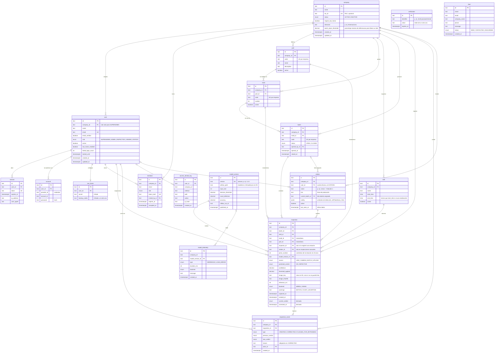

# Modelo de datos multiempresa

Modelo entidad-relación de RikuyDeep. Es la base del esquema Prisma que se creará en HU13 (RIKDP-24).

Tarea: RIKDP-87 (HU07-T02 · modelo entidad-relación multiempresa), dentro de HU08 · Crear la aplicación web.

Decisiones relacionadas: [ADR 0003 · multiempresa con `company_id`](../adr/0003-multiempresa-con-columna-company-id.md), [ADR 0004 · trazabilidad inmutable](../adr/0004-trazabilidad-inmutable.md) y [ADR 0007 · estación de inspección automática](../adr/0007-estacion-de-inspeccion-automatica.md).

## Convenciones

- Tablas y columnas en inglés y `snake_case`: Better Auth exige nombres en inglés para sus tablas (`user`, `session`, `account`, `verification`, `two_factor`), y así todo el esquema queda homogéneo. En Prisma, los modelos van en `PascalCase` con `@@map`.
- Claves primarias `id` de tipo texto (UUID v7 o cuid2, según lo que genere Better Auth).
- Fechas en UTC (`timestamptz`). La zona horaria de cada planta se guarda en `company.timezone` para calcular turnos y reportes.
- Toda tabla de negocio lleva `company_id`. Las únicas tablas sin empresa son las de plataforma: `lead`, `model_version` y las internas de Better Auth.

## Diagrama

## Diccionario de entidades

| Entidad | Qué representa | Historias |
| --- | --- | --- |
| `company` | Empresa cliente (planta de fundición). Una empresa `INACTIVE` no puede iniciar sesión. Puede exigir 2FA a sus usuarios | HU23, HU29 |
| `user` | Usuario con un rol. `company_id` es nulo solo para el superadministrador. `failed_login_count` y `locked_until` implementan el bloqueo tras 5 intentos fallidos. El rol `STATION` es la cuenta técnica de una estación, no una persona | HU19, HU30, HU32, HU44 |
| `session`, `account`, `verification`, `two_factor` | Tablas de Better Auth: sesiones, credenciales (hash de contraseña), tokens de un solo uso (recuperación, 30 min) y secreto TOTP con códigos de respaldo | HU19, HU20, HU29 |
| `invitation` | Invitación por correo para que un usuario cree su contraseña en una empresa con un rol | HU23, HU30 |
| `part` | Pieza que fabrica la empresa | HU31 |
| `mold` | Molde con el que se fabrica una pieza | HU31 |
| `shift` | Turno con horario. Si `end_time < start_time`, cruza la medianoche | HU31 (HU33) |
| `station` | Estación de inspección automática: un computador con cámara en un punto de una línea. Tiene su cuenta técnica, su lote asignado y su configuración de detección. `last_seen_at` permite saber si está en marcha | HU44 |
| `batch` | Lote de producción, hecho con un molde. Estado abierto o cerrado. Solo se inspecciona en lotes abiertos | HU31 (HU33), HU39 |
| `model_version` | Versión publicada del modelo, con sus métricas y el run de MLflow. La versión activa la decide el `manifest.json` en R2 | HU25, HU26 |
| `inspection` | Registro inmutable de una inspección. Guarda una instantánea de molde y pieza, para que el historial no cambie si después se edita un catálogo. La registra una persona (`inspector_id`) o una estación (`station_id`). Solo tiene foto si es defectuosa o forma parte de la muestra de OK | HU24, HU35, HU39, HU44 |
| `inspection_event` | Historial de la inspección: creación, correcciones con motivo y marca para reentrenamiento | HU24, HU40 |
| `lead` | Solicitud de demo desde la landing | HU14 |
| `access_denied_log` | Registro de cada acceso no autorizado (403) | HU32 |
| `rate_limit` | Contadores del rate limit de Better Auth por IP y ruta. Se añadió en la migración `auth_rate_limit` | HU19 |
| `model_telemetry` | Tiempos de inferencia y errores de carga del modelo reportados por el navegador | HU43 |

## Reglas de negocio que el esquema debe garantizar

1. **Aislamiento por empresa.** Todas las consultas de negocio filtran por el `company_id` de la sesión. Las claves de negocio son únicas por empresa: `UNIQUE (company_id, code)` en `part`, `mold` y `batch`.
2. **Coherencia entre empresas.** Un `mold` y su `part`, un `batch` y su `mold`, y una `inspection` con su lote, turno e inspector pertenecen a la misma empresa. Se valida en la capa de datos y con pruebas de aislamiento (RIKDP-173, RIKDP-265).
3. **Inmutabilidad.** `inspection` e `inspection_event` no admiten `DELETE`; `inspection` solo permite actualizar las columnas derivadas `current_verdict` y `corrected_at`, en la misma transacción que el evento `CORRECTED` ([ADR 0004](../adr/0004-trazabilidad-inmutable.md)).
4. **Corrección.** Un evento `CORRECTED` exige `reason`, y `new_verdict` distinto del vigente. Toda corrección genera también `FLAGGED_FOR_RETRAINING` (HU40).
5. **Turno activo.** Para una hora local `h` de la empresa, un turno está activo si `start_time <= h < end_time`, o, cuando cruza la medianoche (`end_time < start_time`), si `h >= start_time` o `h < end_time`.
6. **Lote.** Solo se registran inspecciones en lotes `OPEN`. Al cerrarse, el resumen compara el porcentaje de defectuosas con `company.batch_reject_threshold` para recomendar liberar o rechazar (HU39).
7. **Superadministrador.** `role = SUPERADMIN` si y solo si `company_id` es nulo. Siempre con 2FA (HU29).
8. **Autor de la inspección.** Exactamente uno de `inspector_id` y `station_id` tiene valor. Con `source = LINE`, es `station_id`.
9. **Fotos.** `image_key` es obligatorio si `predicted_verdict = DEFECTIVE`. En las OK de una estación, solo 1 de cada `config.okPhotoEvery`. Las inspecciones manuales (HU35, HU39) siempre guardan foto.
10. **Cuenta de estación.** Un usuario con rol `STATION` solo puede registrar inspecciones de su estación; no accede al dashboard ni a la administración.

## Índices previstos

Pensados para el dashboard (HU37: menos de 2 s con 10 000 inspecciones) y el historial (HU40):

| Tabla | Índice | Para |
| --- | --- | --- |
| `inspection` | `(company_id, captured_at DESC)` | Historial y tendencia diaria |
| `inspection` | `(company_id, station_id, captured_at)` | Contadores de la estación y KPIs por estación |
| `inspection` | `(company_id, batch_id)` | Resumen de lote |
| `inspection` | `(company_id, shift_id, captured_at)` | KPIs y reporte por turno |
| `inspection` | `(company_id, mold_id, current_verdict)` | Ranking de moldes con más defectos |
| `inspection_event` | `(inspection_id, created_at)` | Detalle de una inspección |
| `inspection_event` | `(company_id, type, created_at)` | Exportar imágenes para reentrenamiento |
| `user` | `(company_id, role)` | Listado de usuarios por empresa |

### Volumen

Con estaciones automáticas, cada una registra unas 28 800 inspecciones por turno de 8 horas a 1 pieza por segundo; una planta con 2 estaciones y 3 turnos, unas 170 000 al día. Los índices de arriba bastan para el historial paginado. Para los KPIs del dashboard (HU37) se añadirá una tabla de agregados por hora, estación, molde y veredicto, actualizada en la misma transacción que cada lote de inspecciones, de modo que el dashboard no recorra las inspecciones una a una.

## Roles

Resumen de la matriz de permisos de HU32. El detalle por acción se implementa en RIKDP-179.

| Rol | Alcance |
| --- | --- |
| `SUPERADMIN` | Plataforma: empresas, leads, monitoreo y versiones del modelo |
| `ADMIN` | Su empresa: usuarios, catálogos, lotes, turnos, dashboard y reportes |
| `INSPECTOR` | Su empresa: inspeccionar, corregir veredictos y ver el historial |
| `VIEWER` | Su empresa: solo lectura de dashboard, historial y reportes |
| `STATION` | Cuenta técnica de una estación: registrar inspecciones de esa estación y leer su configuración |
