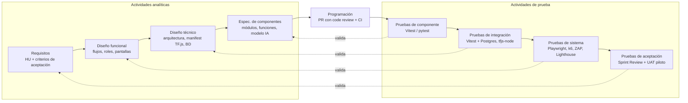

# Plan de pruebas

Inspección de defectos en piezas de fundición con IA.

| Elemento | Detalle |
| --- | --- |
| Proyecto | RikuyDeep (Jira: RIKDP) |
| Documento | Plan de pruebas basado en el modelo en V (HU16 · Estrategia y plan de pruebas, RIKDP-27) |
| Versión | 1.1, aplicada en Jira el 28/10/2026 en las tareas PT1 a PT5 |
| Periodo | 30/09/2026 – 24/11/2026 · Semana 8 a Semana 15 |
| Equipo | David Bravo (Product Owner, fullstack) · Daniel Sánchez (MLOps, inferencia y cámara) · Andre Chumbiraico (ML, datos y catálogos) |

Este archivo es la versión del repositorio del *Plan de Pruebas v1.1*. Los casos de prueba viven en Jira; si algo cambia, se actualiza aquí y en Jira a la vez. La [sección 15](#15-aplicación-en-el-repositorio) recoge cómo se aplica el plan en el código y las diferencias con el documento original.

Documentos relacionados: [Definition of Ready](definition-of-ready.md) · [Definition of Done](definition-of-done.md).

## Resumen

Las pruebas de RikuyDeep siguen los cuatro niveles del modelo en V (componente, integración, sistema y aceptación), más las revisiones estáticas del lado analítico. Hay **67 casos de prueba** en Jira: 65 agrupados en cinco tareas de prueba (PT1–PT5) y 2 de aceptación dentro de la UAT. Las pruebas formales se ejecutan en las **últimas tres semanas** (13 a 15); la aplicación de punta a punta se prueba con **Playwright** y el modelo corre en el navegador con **TensorFlow.js**.

| Nivel | Casos | Herramienta principal |
| --- | --- | --- |
| Estática | 2 | Revisión por pares, checklist, auditoría de dependencias |
| Componente | 11 | Vitest (web) · pytest (ml/) |
| Integración | 23 | Vitest + Postgres de prueba · @tensorflow/tfjs-node · GitHub Actions |
| Sistema | 29 | Playwright · k6 · OWASP ZAP · Lighthouse |
| Aceptación | 2 | Sprint Review por HU · UAT con usuario externo |
| **Total** | **67** | |

> **Cambios respecto a la versión 1.0.** (1) Sin FastAPI ni Hugging Face Spaces: el modelo se exporta a TensorFlow.js y la inferencia corre en el navegador; las pruebas de API se reemplazaron por pruebas de paridad Keras ↔ TF.js y de rendimiento en el navegador. (2) Equipo de tres personas. (3) Las pruebas pasaron de subtareas dentro de cada historia a cinco tareas PT1–PT5 en las Semanas 13 a 15. (4) Se retiraron las pruebas de drift, rollback de despliegue, Docker y robustez con reentrenamiento, porque esas historias se descartaron.

## 1. Propósito y alcance

Este plan define qué se prueba, cómo, con qué herramientas, quién y cuándo, para que cada historia llegue a su Sprint Review con evidencia y el MVP llegue a la demo piloto sin defectos críticos.

**Dentro del alcance**

- Aplicación web Next.js: landing, autenticación (login, recuperación, 2FA), multiempresa y roles, catálogos, inspección por cámara, lote, imagen subida y video, historial, dashboard y reportes.
- Modelo de IA (MobileNetV2): datos, preprocesamiento, entrenamiento, métricas objetivo, regresión en CI, exportación a TensorFlow.js y reentrenamiento con correcciones.
- Inferencia en el navegador con TensorFlow.js: carga del modelo desde el manifest, caché, preprocesamiento idéntico al de entrenamiento, backends WebGL y WASM.
- Pipeline DevOps/MLOps: CI, despliegue en Vercel, migraciones, DVC, MLflow, quality gate y publicación versionada del modelo en R2.
- Requisitos no funcionales: rendimiento, seguridad, accesibilidad, compatibilidad y monitoreo.

**Fuera del alcance**

- Servicios de terceros en sí mismos (Vercel, Neon, Cloudflare R2, Resend, DagsHub); solo se prueba nuestra integración con ellos.
- Línea de producción real en movimiento; la validación se hace con webcam USB, piezas o impresiones y la demo piloto.
- Detección de drift y rollback de despliegues, descartados del MVP.

## 2. Estrategia: modelo en V aplicado a RikuyDeep

Cada actividad analítica produce un entregable que se **verifica** con una revisión estática y que luego **valida** el nivel de prueba simétrico.



| Lado analítico (crea) | Entregable en RikuyDeep | Verificación estática | Nivel que lo valida |
| --- | --- | --- | --- |
| Definición de requisitos | HU con criterios de aceptación en Jira; Definition of Ready | Refinamiento de la HU antes del sprint | Aceptación |
| Diseño funcional | Flujos de usuario, matriz de roles, pantallas | Revisión de flujos con el PO | Sistema |
| Diseño técnico | Arquitectura, modelo de datos Prisma, manifest del modelo TF.js | Revisión de arquitectura (RIKDP-89) | Integración |
| Especificación de componentes | Módulos, funciones, preprocesamiento y modelo | Code review en cada PR, lint y typecheck en CI | Componente |

**Principios**

- **Pruebas formales al final, calidad desde el inicio:** por decisión del equipo, los casos de prueba se ejecutan en las Semanas 13 a 15. Antes de eso cada historia cumple su [Definition of Done](definition-of-done.md): build, lint y typecheck en verde, code review y la prueba de humo de CI.
- **Independencia:** quien desarrolla una historia no ejecuta sus pruebas de integración ni de sistema.
- **Automatizar lo repetible:** componente, integración y E2E corren en GitHub Actions; lo manual se reserva para webcam física, exploratorias y UAT.
- **Riesgo primero:** más profundidad en aislamiento entre empresas, permisos por rol, paridad del modelo en TF.js y métricas del modelo.

## 3. Niveles de prueba

### Estática

| | |
| --- | --- |
| Qué prueba | Revisiones de arquitectura, EDA, selección de modelo y plan; code review en PR; lint, typecheck; auditoría de dependencias. |
| Base de prueba | Documentos y código antes de ejecutarse. |
| Quién | Autor + un revisor distinto |
| Herramientas | GitHub PR, ESLint, TypeScript, Ruff, npm audit, pip-audit |
| Criterio de salida | PR revisados por 1 revisor; 0 errores de lint/typecheck; 0 vulnerabilidades críticas. |

### Componente

| | |
| --- | --- |
| Qué prueba | Funciones aisladas: validaciones, permisos, TOTP, turno activo, KPIs, pre y postproceso TF.js, preprocesamiento en Python, detección de pieza estable. |
| Base de prueba | Especificación de componentes y criterios técnicos. |
| Quién | Quien desarrolló el módulo (PT2) |
| Herramientas | Vitest (web), pytest (ml/) |
| Criterio de salida | 100 % en verde; cobertura ≥ 70 % de líneas en la lógica web y ≥ 80 % en ml/src. |

### Integración

| | |
| --- | --- |
| Qué prueba | Web ↔ Postgres, captura ↔ TF.js ↔ registro, Keras ↔ TF.js, CI ↔ MLflow/DVC, quality gate, aislamiento multiempresa. |
| Base de prueba | Diseño técnico: modelo de datos, manifest y arquitectura. |
| Quién | Tester distinto del desarrollador (PT1, PT3) |
| Herramientas | Vitest + Postgres efímero, @tensorflow/tfjs-node, GitHub Actions |
| Criterio de salida | 100 % en verde antes de fusionar a main; ninguna fuga de datos entre empresas. |

### Sistema

| | |
| --- | --- |
| Qué prueba | La aplicación desplegada: flujos E2E por rol, rendimiento en el navegador, seguridad, accesibilidad, compatibilidad y monitoreo. |
| Base de prueba | Diseño funcional y requisitos no funcionales. |
| Quién | Los tres, por rotación (PT4, PT5) |
| Herramientas | Playwright, k6, OWASP ZAP, Lighthouse, UptimeRobot |
| Criterio de salida | @regression en verde; 0 defectos S1/S2 abiertos; umbrales de la sección 6. |

### Aceptación

| | |
| --- | --- |
| Qué prueba | Criterios de aceptación de cada HU frente al PO y validación del MVP con un usuario externo. |
| Base de prueba | Requisitos: HU y criterios de aceptación. |
| Quién | PO (David) en Review; usuario piloto en UAT |
| Herramientas | Guion UAT, demo en producción |
| Criterio de salida | Toda HU Must aceptada; acta UAT sin hallazgos críticos abiertos. |

## 4. Automatización E2E con Playwright

Playwright (`@playwright/test` con TypeScript) es la herramienta de las pruebas de sistema. Cubre 21 casos del catálogo y la suite se configura en PT4 (RIKDP-263).

| Tema | Decisión |
| --- | --- |
| Ubicación | `apps/web/e2e/` con patrón Page Object y fixtures propios. Selectores por rol accesible o `data-testid`. |
| Navegadores | Proyectos **chromium** y **msedge**. La landing además en 360, 768 y 1280 px. |
| Etiquetas | **@smoke** en cada PR sobre el preview de Vercel (< 3 min); **@regression** antes de la UAT; **@a11y** con `@axe-core/playwright`. |
| Autenticación | Un global setup crea un storageState por rol. El código TOTP se genera en el test con otplib. |
| Webcam | Chromium con `--use-fake-device-for-media-stream`, `--use-fake-ui-for-media-stream` y `--use-file-for-fake-video-capture` con videos .y4m de piezas OK y defectuosas; permiso con `grantPermissions(['camera'])`. |
| TensorFlow.js | La inferencia corre en la página, así que Playwright la ejecuta de verdad. En CI headless se fuerza el backend WASM (o WebGL por SwiftShader) para resultados estables, y se apunta el manifest a una versión fija del modelo para que los veredictos esperados no cambien entre corridas. |
| Datos | Seed de Postgres por ejecución (rama Neon del preview); cada test crea su propia empresa. |
| Descargas | Reportes PDF/Excel se validan capturando el evento `download`. |
| Evidencia | `trace: 'on-first-retry'`, video y captura solo al fallar; el reporte HTML se adjunta al Error en Jira. |
| Tests inestables | Se marcan **@flaky**, se registra un Error y se corrigen en el sprint. Meta: < 2 %. |

## 5. Pruebas del modelo de IA (PT1, Semana 13)

Métricas objetivo: **recall de piezas defectuosas ≥ 95 %** y **accuracy ≥ 97 %** sobre el test reservado. Como el modelo corre en el navegador, además se prueba que la versión TensorFlow.js decide igual que la versión Keras.

| Caso | Nivel | Criterio de aprobación |
| --- | --- | --- |
| Forma y rango del preprocesamiento | Componente | Tensores con la forma de entrada del modelo en el rango esperado |
| Paridad del preprocesamiento Python ↔ TF.js (misma imagen, mismo tensor) | Integración | La misma imagen produce el mismo tensor en Python y en TF.js (tolerancia numérica) |
| Validación de datos con imágenes corruptas y duplicadas de muestra | Componente | El pipeline rechaza las imágenes inválidas de muestra |
| Reproducibilidad: dos corridas con la misma semilla dan las mismas métricas | Componente | Dos corridas con igual semilla dan métricas iguales (± tolerancia) |
| Verificación independiente de métricas en test (recall ≥ 95 %, accuracy ≥ 97 %) | Sistema | Recall ≥ 95 % y accuracy ≥ 97 %, verificado por alguien distinto del autor |
| Un modelo degradado hace fallar el job de regresión en CI | Integración | CI falla con un modelo degradado |
| Paridad Keras ↔ TF.js en el conjunto dorado (≤ 2 discrepancias) | Integración | Como máximo 2 veredictos distintos en ~50 imágenes doradas |
| El quality gate bloquea un modelo bajo la métrica (94,9 % falla, 95,0 % pasa) | Integración | 94,9 % no se publica; 95,0 % sí |
| Evaluación con ≥ 100 imágenes de webcam: caída de métricas documentada | Sistema | Caída de métricas con ≥ 100 imágenes de webcam medida y documentada |

## 6. Pruebas no funcionales y umbrales (PT5, Semana 15)

| Atributo | Umbral de aceptación | Herramienta |
| --- | --- | --- |
| Inferencia en el navegador | p95 < 500 ms por imagen en el equipo de referencia, tras calentar el modelo; veredicto en pantalla < 2 s | Playwright (medición) |
| Carga del modelo | Primera carga medida y documentada; visitas siguientes desde caché (IndexedDB) | Playwright |
| Video | 2 fps durante 10 min sin crecer la memoria de tensores (`tf.memory`) | Playwright |
| Dashboard | Carga en < 2 s con 10.000 inspecciones | k6 + seed |
| Rendimiento del servidor | Registro de inspecciones y dashboard: p95, throughput y tasa de error < 1 % | k6 |
| Seguridad web | OWASP ZAP sin hallazgos altos; CSP compatible con WebGL/WASM, HSTS y CSRF | OWASP ZAP |
| Autorización | 0 accesos a recursos de otra empresa (IDOR) | Playwright + scripts API |
| Dependencias | 0 vulnerabilidades críticas | npm audit, pip-audit |
| Accesibilidad | Lighthouse ≥ 90 en la landing; contraste WCAG AA | Lighthouse CI, checklist |
| Disponibilidad | Una caída simulada de la web o del manifest genera alerta | UptimeRobot |

## 7. Entornos y datos de prueba

| Entorno | Composición | Qué se prueba ahí |
| --- | --- | --- |
| Local | Next.js en desarrollo + Postgres (rama dev de Neon) | Componente e integración mientras se desarrolla |
| CI (GitHub Actions) | Postgres como service container; tfjs-node; modelo de prueba fijo | Lint, typecheck, componente, integración, regresión y paridad del modelo |
| Preview (Vercel) | Preview por PR + rama Neon + manifest de staging en R2 | Playwright @smoke en cada PR; @regression en la Semana 15 |
| Producción | Vercel producción + manifest activo en R2 | Humo post-despliegue, monitoreo y UAT |

- **Dataset de Kaggle** versionado con DVC, con split de test bloqueado; **conjunto dorado** de ~50 imágenes.
- **Set de webcam** de ≥ 100 imágenes y videos .y4m de piezas OK y defectuosas para Playwright.
- **Seed de BD** con 2 empresas y los 4 roles; seed masivo de 10.000 inspecciones; imágenes inválidas para validaciones.
- Nunca se usan datos personales reales.

## 8. Criterios de entrada, salida y suspensión

| Criterio | Definición |
| --- | --- |
| Entrada a pruebas formales (Semana 13) | Historias de las Semanas 8 a 12 terminadas y desplegadas en preview; @smoke en verde. |
| Salida de una HU (Done) | Criterios demostrados en la Review, code review hecho, CI en verde; sus casos formales quedan en PT1–PT5. Detalle en la [Definition of Done](definition-of-done.md). |
| Salida de PT1–PT3 | Todos los casos en verde o con defecto registrado y priorizado; 0 defectos S1 abiertos. |
| Salida del proyecto | @regression en verde, umbrales no funcionales cumplidos, métricas del modelo cumplidas y acta UAT sin hallazgos críticos abiertos. |
| Suspensión | Preview caído más de medio día o más del 30 % de @smoke en rojo: se corrige el build antes de seguir. |

## 9. Gestión de defectos

Cada defecto se registra en Jira como **Error**, con la etiqueta `defecto`, vinculado al caso de prueba y a la historia, con pasos, resultado esperado y obtenido, entorno, versión del modelo y evidencia de Playwright.

| Severidad | Ejemplos | Tratamiento |
| --- | --- | --- |
| S1 · Bloqueante | Caída, pérdida de datos, fuga entre empresas, el modelo aprueba piezas defectuosas de forma masiva | Se corrige antes de cerrar el sprint; bloquea la UAT |
| S2 · Mayor | Un flujo principal falla sin alternativa | Se corrige dentro del sprint |
| S3 · Menor | Falla con alternativa disponible | Siguiente sprint o backlog |
| S4 · Cosmético | Textos, alineaciones | Backlog |

## 10. Calendario de pruebas

| Sprint | Fechas | Pruebas |
| --- | --- | --- |
| Semanas 8–12 | 30/09–03/11 | Sin tareas de prueba formales. Verificación estática: code review en cada PR, revisiones de EDA, arquitectura, plan y selección del modelo; CI con lint, typecheck y humo. |
| Semana 13 | 04/11–10/11 | **PT1 · Pruebas del modelo de IA** (9 casos). |
| Semana 14 | 11/11–17/11 | **PT2 · Componente** (8 casos) y **PT3 · Integración** (19 casos). |
| Semana 15 | 18/11–24/11 | **PT4 · Sistema con Playwright** (17 casos), **PT5 · No funcionales** (12 casos) y **UAT** (2 casos de aceptación + corrección de defectos críticos). |

## 11. Organización en Jira

| Clave | Tarea de prueba | Sprint | Coordina | Casos |
| --- | --- | --- | --- | --- |
| RIKDP-250 | PT1 · Pruebas del modelo de IA | Semana 13 | Andre Chumbiraico | 9 |
| RIKDP-251 | PT2 · Pruebas de componente (unitarias) | Semana 14 | David Bravo | 8 |
| RIKDP-252 | PT3 · Pruebas de integración | Semana 14 | Andre Chumbiraico | 19 |
| RIKDP-253 | PT4 · Pruebas de sistema E2E con Playwright | Semana 15 | Daniel Sánchez | 17 |
| RIKDP-61 | PT5 · Pruebas no funcionales: rendimiento, seguridad y accesibilidad | Semana 15 | Andre Chumbiraico | 12 |

- Cada PT es una **Tarea** de la épica EP11, con fechas y sprint; cada caso es una **subtarea** con responsable asignado.
- Etiquetas: `pruebas`, el nivel (`nivel-componente`, `nivel-integracion`, `nivel-sistema`, `nivel-aceptacion`, `nivel-estatica`) y, según el caso, `playwright`, `modelo-ia`, `rendimiento`, `seguridad`, `accesibilidad`.
- Filtro de todas las pruebas: `project = RIKDP AND labels = pruebas`. Revisiones estáticas: `labels = revision`.
- Las tareas de prueba no llevan story points; solo las historias los llevan.

## 12. Roles y carga de pruebas

| Persona | Rol en pruebas |
| --- | --- |
| David Bravo | Product Owner: acepta las HU en la Review y firma el acta UAT. Coordina PT2 y ejecuta pruebas de sistema de la inspección con cámara. |
| Daniel Sánchez | Coordina PT4: configura la suite Playwright y la regresión. Ejecuta pruebas de CI, DVC/MLflow, aislamiento y rendimiento. |
| Andre Chumbiraico | Coordina PT1, PT3 y PT5: pruebas del modelo, integración y no funcionales. |

| Persona | Semana 13 | Semana 14 | Semana 15 | Total |
| --- | --- | --- | --- | --- |
| David Bravo | 3 | 10 | 11 | **24** |
| Daniel Sánchez | 3 | 10 | 11 | **24** |
| Andre Chumbiraico | 3 | 7 | 9 | **19** |

## 13. Riesgos de las pruebas

| Riesgo | Impacto | Mitigación |
| --- | --- | --- |
| Pruebas concentradas en 3 semanas: los defectos aparecen tarde | Alto | @smoke en CI desde la Semana 9, PT1 en la Semana 13 y Semana 15 sin funcionalidades nuevas |
| La versión TF.js decide distinto que la versión Keras | Alto | Paridad en el conjunto dorado antes de publicar (quality gate) y en PT1 |
| Rendimiento variable según el equipo del inspector | Medio | Equipo de referencia definido; fallback WASM; medir carga en frío y en caliente |
| Webcam física e iluminación | Medio | Cámara simulada en Playwright, set propio de ≥ 100 imágenes y prueba manual en 2 navegadores |
| El dataset de Kaggle no representa la planta | Medio | Evaluación con imágenes de webcam (PT1) y UAT con usuario externo |
| Equipo de tres personas | Medio | Carga de pruebas repartida en partes iguales y nadie prueba lo que desarrolló |

## 14. Métricas e informes

- Casos ejecutados y aprobados por nivel y por PT; cobertura de código; defectos por severidad; tests inestables.
- Del modelo, por versión: recall de defectuosas, accuracy, falsos negativos, diferencias Keras ↔ TF.js; registradas en MLflow.
- Al cierre: tasa de escape (defectos hallados en la UAT), tiempo medio de corrección y defectos por épica.

## 15. Aplicación en el repositorio

### Qué está configurado (HU16)

| Pieza | Dónde | Cómo se ejecuta |
| --- | --- | --- |
| Componente e integración web | Vitest, archivos `*.test.ts` junto al código; las pruebas con base de datos se saltan sin `DATABASE_URL` | `npm test` en `apps/web` |
| Componente ML | pytest en `ml/tests/` | `pytest` en `ml/` |
| Sistema (E2E) | Playwright en `apps/web/e2e/`: `playwright.config.ts`, Page Objects en `e2e/pages/`, fixtures en `e2e/fixtures.ts` | `npm run test:e2e`; solo humo con `npm run test:smoke` |
| Prueba de humo en CI | Job `Web` del workflow `CI`: tras el build, `npm run test:smoke` contra la compilación de producción y el Postgres del job. Si falla, se sube el reporte HTML y las trazas como artefacto `playwright-report` | En cada PR y en cada push a `main` |
| Estática | ESLint, `tsc`, `npm audit`, Ruff, revisión de dependencias y convenciones de la PR en el mismo workflow | En cada PR |

La prueba de humo actual (`e2e/landing.spec.ts`, etiqueta `@smoke`) comprueba que la landing carga, que el formulario de demo marca los campos obligatorios y que una solicitud válida llega al servidor y se guarda como lead. Cada historia nueva con pantalla añade sus casos `@smoke` o `@regression` a esa carpeta.

### Ejecutar Playwright en local

```bash
cd apps/web
npx playwright install chromium   # solo la primera vez
npm run build
npm run test:smoke
```

- Sin `PLAYWRIGHT_BASE_URL`, Playwright levanta `next start` en el puerto 3100. Con `PLAYWRIGHT_BASE_URL=https://…` prueba una URL ya desplegada, por ejemplo el preview de Vercel de una PR.
- `PLAYWRIGHT_EDGE=1` añade el proyecto **msedge** (requiere Microsoft Edge instalado).
- `E2E_EXPECT_DATABASE=1` exige que la solicitud de demo se guarde; sin esa variable también se acepta el aviso de «envío no activo» de un entorno sin base de datos.
- El reporte queda en `playwright-report/` (`npx playwright show-report`).

### Diferencias con el documento v1.1

| Punto del plan | Aplicación actual | Motivo |
| --- | --- | --- |
| @smoke sobre el preview de Vercel | @smoke en el job de CI contra la compilación de producción y Postgres 16 | El preview no está disponible para GitHub Actions sin un token de Vercel. La configuración ya acepta `PLAYWRIGHT_BASE_URL` para apuntar al preview cuando se conecte (PT4, RIKDP-263). |
| Proyectos chromium y msedge | chromium siempre; msedge opcional con `PLAYWRIGHT_EDGE=1` | Los runners de CI no traen Edge. Se activa en la regresión de la Semana 15. |
| Preprocesamiento 224×224×3 (RIKDP-84) | El modelo usa entrada **400×400×3**; RIKDP-84 ya está corregido en Jira | Decisión de HU17/HU08 ([ADR 0006](../adr/0006-manifest-de-modelos.md), [inferencia en el navegador](../arquitectura/inferencia-navegador.md)). |
| Code review aprobado por 1 revisor | La PR se fusiona sola cuando el check `CI` pasa (auto-merge, sin aprobación obligatoria) | Decisión del equipo por trabajar en horarios distintos. La revisión sigue en la DoD, pero no bloquea la fusión: sus hallazgos se registran como Error. |
| Inspección en video (HU44) | HU44 es la estación automática que inspecciona el 100 % de las piezas en la línea | [ADR 0007](../adr/0007-estacion-de-inspeccion-automatica.md). Los casos RIKDP-229, RIKDP-230 y RIKDP-260 se aplican a esa estación. |

## Anexo A. Catálogo de casos de prueba en Jira

67 casos ordenados por tarea de prueba. Los marcados con ★ son casos nuevos de la v1.1; el resto viene de las subtareas de prueba originales de cada historia.

| Clave | PT | Nivel | Caso de prueba | Herramienta | Resp. | HU |
| --- | --- | --- | --- | --- | --- | --- |
| RIKDP-84 | PT1 | Componente | Forma y rango del preprocesamiento (400×400×3) | pytest | A. Chumbiraico | HU06 |
| RIKDP-85 | PT1 | Integración | Paridad del preprocesamiento Python ↔ TF.js (misma imagen, mismo tensor) | pytest + tfjs-node | D. Sánchez | HU06 |
| RIKDP-96 | PT1 | Componente | Validación de datos con imágenes corruptas y duplicadas de muestra | pytest | D. Sánchez | HU10 |
| RIKDP-101 | PT1 | Componente | Reproducibilidad: dos corridas con la misma semilla dan las mismas métricas | pytest | D. Bravo | HU10 |
| RIKDP-131 | PT1 | Sistema | Verificación independiente de métricas en test (recall ≥ 95 %, accuracy ≥ 97 %) | pytest + scikit-learn | D. Sánchez | HU17 |
| RIKDP-145 | PT1 | Integración | Un modelo degradado hace fallar el job de regresión en CI | GitHub Actions + pytest | D. Bravo | HU22 |
| RIKDP-154 | PT1 | Integración | Paridad Keras ↔ TF.js en el conjunto dorado (≤ 2 discrepancias) | tfjs-node + pytest | D. Bravo | HU25 |
| RIKDP-166 | PT1 | Integración | El quality gate bloquea un modelo bajo la métrica (94,9 % falla, 95,0 % pasa) | GitHub Actions | A. Chumbiraico | HU25 |
| RIKDP-254 ★ | PT1 | Sistema | Evaluación con ≥ 100 imágenes de webcam: caída de métricas documentada | pytest + set webcam | A. Chumbiraico | HU17 |
| RIKDP-135 | PT2 | Componente | Unitarias de validación de login, sesión y token de recuperación | Vitest | D. Bravo | HU19 |
| RIKDP-255 ★ | PT2 | Componente | Unitarias de TOTP y códigos de respaldo (ventana de tiempo, un solo uso) | Vitest | D. Bravo | HU29 |
| RIKDP-256 ★ | PT2 | Componente | Unitarias de la matriz de permisos (4 roles × acciones) | Vitest | D. Bravo | HU32 |
| RIKDP-257 ★ | PT2 | Componente | Unitarias del turno activo (incluye cruce de medianoche) y de catálogos | Vitest | A. Chumbiraico | HU31 |
| RIKDP-258 ★ | PT2 | Componente | Unitarias del preprocesamiento y postproceso TF.js (umbral → veredicto) | Vitest | D. Sánchez | HU26 |
| RIKDP-259 ★ | PT2 | Componente | Unitarias de KPIs del dashboard y del resumen de lote | Vitest | D. Sánchez | HU37 |
| RIKDP-260 ★ | PT2 | Componente | Unitarias de detección de pieza estable (fotogramas borrosos) | pytest | A. Chumbiraico | HU44 |
| RIKDP-261 ★ | PT2 | Componente | Reporte de cobertura en CI (≥ 70 % web, ≥ 80 % ml/src) | Vitest / pytest --cov | D. Sánchez | – |
| RIKDP-65 | PT3 | Integración | Un PR sin aprobación no puede fusionarse a main | GitHub (manual) | D. Bravo | HU01 |
| RIKDP-69 | PT3 | Integración | Un PR con error de lint o prueba fallida queda bloqueado | GitHub Actions | D. Bravo | HU02 |
| RIKDP-77 | PT3 | Integración | dvc pull en una máquina limpia reproduce los mismos hashes | DVC + pytest | D. Sánchez | HU04 |
| RIKDP-104 | PT3 | Integración | Una corrida de entrenamiento aparece completa en MLflow (DagsHub) | MLflow / DagsHub | D. Sánchez | HU10 |
| RIKDP-113 | PT3 | Integración | Migración desde cero y rollback en la rama dev de Neon | Prisma Migrate | A. Chumbiraico | HU13 |
| RIKDP-117 | PT3 | Integración | Lead válido se guarda y lead inválido se rechaza | Vitest + Postgres de prueba | A. Chumbiraico | HU12 |
| RIKDP-120 | PT3 | Integración | Un PR genera preview en Vercel y main despliega a producción | Vercel + Playwright (humo) | D. Bravo | HU13 |
| RIKDP-151 | PT3 | Integración | Trazabilidad: registro completo e inmutable, imagen en R2 | Vitest + Postgres de prueba | D. Bravo | HU24 |
| RIKDP-158 | PT3 | Integración | Inferencia TF.js con imágenes OK, defectuosas e inválidas | Vitest + @tensorflow/tfjs-node | D. Bravo | HU26 |
| RIKDP-174 | PT3 | Integración | Aislamiento entre empresas en usuarios y consultas | Vitest + Postgres de prueba | D. Sánchez | HU30 |
| RIKDP-178 | PT3 | Integración | Catálogos de piezas y moldes aislados por empresa | Vitest + Postgres de prueba | D. Sánchez | HU31 |
| RIKDP-182 | PT3 | Integración | Permisos por rol y endpoint: 403 y registro del intento | Vitest + Postgres de prueba | A. Chumbiraico | HU32 |
| RIKDP-186 | PT3 | Integración | Lotes y turnos: estados y turno activo | Vitest + Postgres de prueba | D. Bravo | HU31 |
| RIKDP-195 | PT3 | Integración | Captura → inferencia TF.js → registro de la inspección | Vitest + Playwright | A. Chumbiraico | HU35 |
| RIKDP-204 | PT3 | Integración | Agregados del dashboard con datos seed | Vitest + datos seed | A. Chumbiraico | HU37 |
| RIKDP-208 | PT3 | Integración | El reporte PDF/Excel coincide con el dashboard | Vitest | D. Sánchez | HU37 |
| RIKDP-212 | PT3 | Integración | Inspección de un lote de 50 imágenes y su resumen | pytest + Vitest | D. Bravo | HU39 |
| RIKDP-237 | PT3 | Integración | Reentrenamiento completo con quality gate y publicación TF.js | GitHub Actions + MLflow | D. Sánchez | HU46 |
| RIKDP-262 ★ | PT3 | Integración | La corrección queda en la trazabilidad y la imagen se marca para reentrenamiento | Vitest + Postgres de prueba | D. Sánchez | HU40 |
| RIKDP-108 | PT4 | Sistema | Landing responsive en 360, 768 y 1280 px | Playwright (viewports) | A. Chumbiraico | HU12 |
| RIKDP-136 | PT4 | Sistema | Login correcto, incorrecto y bloqueo por intentos | Playwright | A. Chumbiraico | HU19 |
| RIKDP-139 | PT4 | Sistema | Recuperación de contraseña: enlace válido, expirado y reutilizado | Playwright | A. Chumbiraico | HU19 |
| RIKDP-148 | PT4 | Sistema | Alta de empresa e invitación del administrador | Playwright | D. Sánchez | HU23 |
| RIKDP-170 | PT4 | Sistema | 2FA: activación, login con TOTP y código de respaldo | Playwright | A. Chumbiraico | HU29 |
| RIKDP-175 | PT4 | Sistema | Invitar, aceptar y desactivar un usuario de planta | Playwright | D. Sánchez | HU30 |
| RIKDP-183 | PT4 | Sistema | Cada rol solo ve y usa su menú (4 roles) | Playwright (4 roles) | D. Sánchez | HU32 |
| RIKDP-190 | PT4 | Sistema | Inspección con cámara simulada (fake media stream) | Playwright (fake media stream) | D. Bravo | HU35 |
| RIKDP-191 | PT4 | Sistema | Prueba manual con webcam física en Chrome y Edge | Manual (Chrome y Edge) | D. Bravo | HU35 |
| RIKDP-196 | PT4 | Sistema | Captura → veredicto en pantalla en < 2 s | Playwright | D. Bravo | HU35 |
| RIKDP-213 | PT4 | Sistema | Modo lote de punta a punta | Playwright | D. Bravo | HU39 |
| RIKDP-216 | PT4 | Sistema | Corregir un veredicto y ver el evento en el historial | Playwright | D. Sánchez | HU40 |
| RIKDP-218 | PT4 | Sistema | Subida de imagen válida e inválida | Playwright | D. Bravo | HU39 |
| RIKDP-221 | PT4 | Sistema | Búsqueda en el historial y vista de detalle | Playwright | A. Chumbiraico | HU40 |
| RIKDP-229 | PT4 | Sistema | Video simulado de piezas: veredicto por pieza | Playwright (video simulado) | D. Sánchez | HU44 |
| RIKDP-263 ★ | PT4 | Sistema | Configurar la suite Playwright: Chromium y Edge, sesión por rol, cámara simulada, @smoke/@regression | Playwright | D. Sánchez | – |
| RIKDP-264 ★ | PT4 | Sistema | Regresión completa @regression antes de la UAT | Playwright | D. Sánchez | – |
| RIKDP-92 | PT5 | Estática | Contraste de la paleta WCAG AA | Checklist WCAG AA | D. Bravo | HU08 |
| RIKDP-109 | PT5 | Sistema | Auditoría Lighthouse ≥ 90 de la landing | Lighthouse CI | D. Bravo | HU12 |
| RIKDP-159 | PT5 | Sistema | Inferencia en el navegador: p95 < 500 ms por imagen y veredicto < 2 s | Playwright (medición en navegador) | D. Sánchez | HU26 |
| RIKDP-205 | PT5 | Sistema | Dashboard en < 2 s con 10.000 inspecciones | k6 + seed 10.000 | A. Chumbiraico | HU37 |
| RIKDP-225 | PT5 | Sistema | Caída simulada genera alerta en UptimeRobot | UptimeRobot (manual) | D. Bravo | HU43 |
| RIKDP-230 | PT5 | Sistema | Video a 2 fps durante 10 min sin fugas de memoria (tf.memory) | Playwright (tf.memory) | A. Chumbiraico | HU44 |
| RIKDP-242 | PT5 | Sistema | Escaneo OWASP ZAP sin hallazgos altos | OWASP ZAP | A. Chumbiraico | HU48 |
| RIKDP-243 | PT5 | Estática | Auditoría de dependencias (npm audit, pip-audit) | npm audit / pip-audit / Dependabot | D. Sánchez | HU48 |
| RIKDP-247 | PT5 | Sistema | Scripts k6 del dashboard y del registro de inspecciones | k6 | D. Sánchez | – |
| RIKDP-248 | PT5 | Sistema | Ejecución de k6 y reporte de p95, throughput y errores | k6 | D. Sánchez | – |
| RIKDP-249 | PT5 | Sistema | Revisión de resultados de rendimiento y recomendaciones | Revisión de reporte k6 | A. Chumbiraico | – |
| RIKDP-265 ★ | PT5 | Sistema | Acceso a recursos de otra empresa (IDOR) en API y pantallas | Playwright + scripts API | D. Bravo | HU48 |
| RIKDP-245 | HU49 | Aceptación | Ejecución de UAT con usuario externo | Guion UAT (manual) | D. Bravo | HU49 |
| RIKDP-246 | HU49 | Aceptación | Acta de UAT y triage de hallazgos | Guion UAT (manual) | D. Bravo | HU49 |

## Anexo B. Matriz de trazabilidad historia × nivel

Casos de cada nivel que validan cada historia vigente. Toda historia, además, pasa por aceptación en su Sprint Review.

| HU | Historia | Spr. | SP | Com. | Int. | Sis. | Ace. | Total |
| --- | --- | --- | --- | --- | --- | --- | --- | --- |
| HU01 | Crear repositorio en github | S8 | 1 | · | 1 | · | · | 1 |
| HU02 | Pipeline de integración continua | S8 | 1 | · | 1 | · | · | 1 |
| HU04 | Ingestar y versionar el dataset | S8 | 1 | · | 1 | · | · | 1 |
| HU06 | Análisis exploratorio, preprocesamiento y augmentation del dataset | S8 | 3 | 1 | 1 | · | · | 2 |
| HU08 | Crear la Aplicación web | S8 | 3 | · | · | · | · | 1 |
| HU10 | Entrenar el modelo base con datos validados y experimentos registrados | S9 | 5 | 2 | 1 | · | · | 3 |
| HU12 | Landing page con propuesta de valor y solicitud de demo | S9 | 2 | · | 1 | 2 | · | 3 |
| HU13 | Base de datos, migraciones y despliegue automático de la web | S9 | 3 | · | 2 | · | · | 2 |
| HU16 | Estrategia y plan de pruebas | S9 | 2 | · | · | · | · | · |
| HU17 | Ajustar y evaluar el modelo contra la métrica objetivo | S10 | 5 | · | · | 2 | · | 2 |
| HU19 | Iniciar sesión y recuperar la contraseña | S10 | 3 | 1 | · | 2 | · | 3 |
| HU22 | Pruebas de regresión del modelo en CI | S10 | 2 | · | 1 | · | · | 1 |
| HU23 | Gestionar empresas como superadministrador | S10 | 3 | · | · | 1 | · | 1 |
| HU24 | Registrar la trazabilidad de cada inspección | S10 | 3 | · | 1 | · | · | 1 |
| HU25 | Exportar el modelo a TensorFlow.js con quality gate | S11 | 5 | · | 2 | · | · | 2 |
| HU26 | Inferencia en el navegador con TensorFlow.js | S11 | 5 | 1 | 1 | 1 | · | 3 |
| HU29 | Activar la verificación en dos pasos (2FA) | S11 | 3 | 1 | · | 1 | · | 2 |
| HU30 | Gestionar usuarios de mi planta | S12 | 3 | · | 1 | 1 | · | 2 |
| HU31 | Gestionar catálogos de piezas, moldes, lotes y turnos | S12 | 5 | 1 | 2 | · | · | 3 |
| HU32 | Acceder según mi rol | S12 | 2 | 1 | 1 | 1 | · | 3 |
| HU35 | Inspeccionar una pieza con la webcam | S12 | 3 | · | 1 | 3 | · | 4 |
| HU37 | Dashboard de calidad por turno y reporte descargable | S13 | 2 | 1 | 2 | 1 | · | 4 |
| HU39 | Inspeccionar un lote de piezas o una imagen subida | S13 | 5 | · | 1 | 2 | · | 3 |
| HU40 | Corregir veredictos y consultar el historial | S13 | 3 | · | 1 | 2 | · | 3 |
| HU43 | Monitorear la salud de la aplicación y del modelo | S13 | 2 | · | · | 1 | · | 1 |
| HU44 | Inspeccionar en video en tiempo real | S14 | 5 | 1 | · | 2 | · | 3 |
| HU46 | Reentrenar el modelo con las correcciones | S14 | 3 | · | 1 | · | · | 1 |
| HU48 | Hardening de seguridad | S14 | 3 | · | · | 2 | · | 3 |
| HU49 | Validar el MVP en una demo piloto (UAT) | S15 | 3 | · | · | · | 2 | 2 |

SP según Jira al 28/10/2026 (el equipo ajustó HU04 a 1 SP y HU37 a 2 SP). Casos sin historia asociada: configuración de Playwright, regresión completa y cobertura en CI. HU08 suma 1 caso estático (RIKDP-92) y HU48 suma 1 caso estático (RIKDP-243), que la matriz no muestra por columna.
